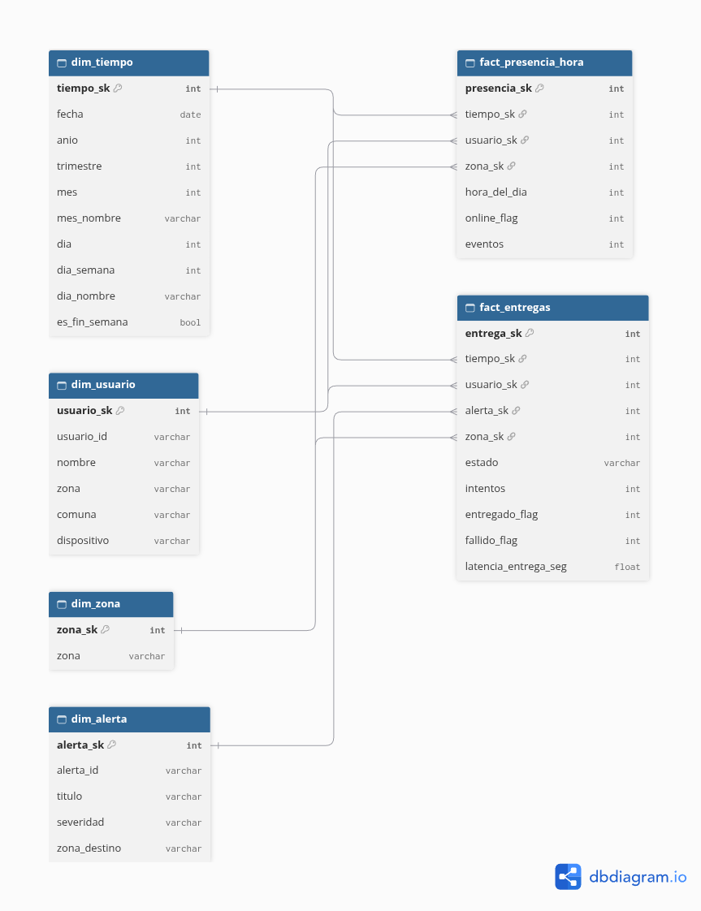

# ComunicaMedellín — Mini-Lakehouse (Taller 3)

**Equipo 3** · Tópicos Avanzados en Bases de Datos · ITM 2026

Extiende el proyecto operacional de ComunicaMedellín (`comunicamedellin-grupo3/`,
Módulos 1 y 2) con una capa analítica mínima pero completa: un pipeline
ETL que mueve datos del OLTP (Cassandra) a un lakehouse en capas
Bronze/Silver/Gold sobre Parquet, modelado con un esquema dimensional en
constelación y consultado con DuckDB.

## Descripción

El dominio de negocio es el mismo del sistema operacional: alertas
ciudadanas con fan-out masivo y presencia de usuarios en tiempo real. Este
taller responde una pregunta distinta a la del Módulo 1 — ya no "¿qué
motor OLTP usar?" sino "¿qué tan efectivo fue el fan-out y qué patrones
de presencia hay por zona?", algo que Cassandra no puede responder sin
`ALLOW FILTERING` (ver demo `demo-analitica` del proyecto base).

Se modelan dos procesos de negocio en un **esquema en constelación**:

- **FACT_ENTREGAS** — granularidad: una fila = un intento de entrega de
  una alerta a un usuario (fuente: `estado_entrega` + `historial_usuario`).
- **FACT_PRESENCIA_HORA** — granularidad: una fila = un snapshot de
  presencia de un usuario en una hora (fuente: `presencia`).

Ver el diseño completo (las 5 preguntas del Paso 1) en
[`docs/modelo_dimensional.md`](docs/modelo_dimensional.md).

## Arquitectura

```
Cassandra (OLTP) → Bronze (raw) → Silver (limpio) → Gold (dimensional) → DuckDB
```

Ver diagrama ASCII completo en
[`docs/arquitectura_lakehouse.txt`](docs/arquitectura_lakehouse.txt) y el
diagrama del modelo estrella/constelación en
[`docs/modelo_dimensional.png`](docs/modelo_dimensional.png) (fuente DBML
en [`docs/modelo_dimensional.dbml`](docs/modelo_dimensional.dbml), editable
en [dbdiagram.io](https://dbdiagram.io)):



Herramientas: **Python + pandas** (ETL), **DuckDB** (motor analítico
columnar), **Parquet** (formato del lake), **cassandra-driver** (lectura
del OLTP real).

## Requisitos

- Python 3.10+
- El clúster de Cassandra del proyecto base corriendo (`comunicamedellin-grupo3/`):
  ```bash
  cd ../comunicamedellin-grupo3
  make up       # levanta cass1/cass2/cass3 (~2 min la primera vez)
  make schema   # crea el keyspace 'comunica'
  make seed     # 10.000 usuarios simulados
  ```
- `pip install -r requirements.txt`

## Poblar datos de alertas (una sola vez)

El Módulo 1 solo siembra usuarios (`presencia`). Este taller necesita
además volumen y variedad en `alertas`, `historial_usuario` y
`estado_entrega`, así que agrega su propio seed:

```bash
python scripts/seed_alertas.py
```

Genera 60 alertas reales (severidades `info`/`advertencia`/`critica`,
repartidas en los últimos 30 días y en las 3 zonas) y hace fan-out real a
una muestra de usuarios, escribiendo en Cassandra. Solo hace falta
correrlo una vez; el pipeline del lakehouse lee lo que ya está en el
clúster.

## Ejecutar el pipeline completo

```bash
pip install -r requirements.txt
python scripts/seed_alertas.py   # solo la primera vez
python main.py
```

`main.py` corre `extract.py → transform_silver.py → transform_gold.py →
analyze.py → reporte_negocio.py` en secuencia y se detiene si algún paso
falla.

## Calidad de datos: suciedad deliberada

`seed_alertas.py` no escribe datos perfectos. Inyecta, con probabilidad
controlada, exactamente lo que Cassandra deja escribir sin violar su
propio esquema (nada fabricado fuera del motor real):

| Suciedad | Dónde | Regla de Silver |
|---|---|---|
| Severidad nula | `historial_usuario` | **Se descarta** — campo crítico, no se infiere sin inventar el dato |
| Zona destino nula | `alertas` | **Se infiere** cruzando con la zona real de los destinatarios en `historial_usuario` |
| Estado de entrega nulo | `estado_entrega` | **Se descarta** — sin él no se puede clasificar éxito/fallo |
| Severidad con formato sucio (`" CRITICA"`, `"Critica "`) | `historial_usuario` | **Se normaliza** (`.strip().lower()`) — el dato está completo, solo mal escrito |
| Intentos negativo | `estado_entrega` | **Se descarta** — valor imposible por definición |
| Reloj desincronizado (`actualizado` < `enviado_en`) | `estado_entrega` | **Se descarta y se reporta como error de reloj distribuido** — en un sistema AP (Sec. 1.2, consistencia eventual) dos escrituras concurrentes pueden registrarse fuera de orden |

Criterio general: **campo crítico sin el cual la fila no se puede
interpretar honestamente → se descarta; campo no crítico que se puede
inferir de otra fuente del mismo dataset → se rellena cruzando tablas,
nunca con un valor inventado desde cero.**

No se simulan duplicados: la `PRIMARY KEY` de cada tabla (ver
`infra/cql/schema.cql` del proyecto base) hace que Cassandra sobreescriba
cualquier reintento con la misma clave, así que un duplicado real nunca
llegaría a Bronze — simularlo habría sido inventar un escenario que el
motor no produce.

El reporte completo (cuántas filas cayeron por cada regla, no solo un
total agregado) queda en
[`docs/reporte_calidad.txt`](docs/reporte_calidad.txt).

## Reporte de negocio: North Star, apoyo y vanity metrics

`scripts/reporte_negocio.py` responde la pregunta que de verdad importa
en Gold: no "¿las tablas están bien hechas?" sino "¿qué le dice esto al
negocio?". Usa el framework de tres niveles:

- **North Star Metric — % de entregas a tiempo (≤ 90s).** La única
  métrica que resume si ComunicaMedellín cumple su promesa central:
  que una alerta de riesgo público *llegue* y llegue *rápido*. Es
  accionable (cualquier equipo tiene una palanca real sobre ella) y no
  se puede inflar sin mejorar el servicio de verdad.
- **Métricas de apoyo** — explican el *por qué* sube o baja la North
  Star: tasa de fallo por severidad, latencia p50/p90 por zona, % de
  destinatarios online al momento del envío (con su limitación
  documentada: `presencia` es un snapshot, no un historial exacto).
- **Vanity metrics** — alertas publicadas, usuarios registrados,
  entregas históricas totales. Se ven bien en una diapositiva, pero
  siempre suben con el tiempo y no dicen si el producto funciona.

```bash
python scripts/reporte_negocio.py
```

## Resultados del Benchmark

Consulta: contar entregas fallidas sobre toda la tabla de hechos (que en
Cassandra exige recorrer `estado_entrega` completa con `ALLOW FILTERING`,
porque `estado` no es parte de la partition key).

| Motor | Query | Tiempo | Filas |
|---|---|---|---|
| Cassandra (OLTP, `ALLOW FILTERING`) | Entregas fallidas, todo el dataset | ~160 ms | 72.000 |
| DuckDB (columnar, sobre Gold) | misma consulta | ~1.2 ms | 63.822 |

**Factor de mejora: ~100-150x** (varía por corrida; ver salida real de
`python scripts/analyze.py`). La diferencia entre las dos cuentas de filas
es la limpieza real de Silver, no un error de medición.

Con decenas de miles de filas la diferencia ya es significativa porque la consulta en
Cassandra fuerza un escaneo completo de todas las particiones del
clúster (lo que el modelo NoSQL del Módulo 2 justamente evita para las
consultas de servicio); DuckDB en cambio solo lee las dos columnas
(`fallido_flag`) que necesita del Parquet columnar. La ventaja crecería
aún más con datasets de cientos de miles de filas, donde Cassandra además
empieza a sufrir timeouts de coordinador en el `ALLOW FILTERING`.

## Reporte de calidad Silver

Generado automáticamente en cada corrida: [`docs/reporte_calidad.txt`](docs/reporte_calidad.txt).

## Demo interactiva (como la del Módulo 2)

Igual que `comunicamedellin-grupo3/frontend/taller.html`, hay una página con
un botón por cada paso del taller que ejecuta el script real (no una
simulación) y muestra el comando, la salida y las métricas en vivo:

```bash
cd ../comunicamedellin-grupo3
make api          # terminal 1 → API FastAPI en :8765 (monta api/lakehouse.py)
```

Luego abre [`lakehouse.html`](lakehouse.html) en el navegador (doble clic,
sin build ni servidor de frontend). Los 6 puntos:

| Punto | Qué ejecuta de verdad |
|---|---|
| 00 · Poblar alertas | `scripts/seed_alertas.py` — una vez, antes del resto |
| 01 · Bronze | `scripts/extract.py` contra Cassandra real |
| 02 · Silver | `scripts/transform_silver.py` + reporte de calidad |
| 03 · Gold | `scripts/transform_gold.py` — 4 dimensiones + 2 hechos |
| 04 · Las 5 consultas | `scripts/analyze.py`, tiempos medidos reales |
| 05 · Benchmark | Cassandra (`ALLOW FILTERING`) vs DuckDB, factor de mejora real |

El backend de esta demo (`api/lakehouse.py`, en el repo del proyecto base)
corre cada script del taller con `subprocess` y parsea su salida real para
emitirla paso a paso por WebSocket — el mismo patrón que `api/taller.py`
del Módulo 2.

## Estructura

```
ENTREGA3/
├── lakehouse/
│   ├── bronze/              ← Parquet raw de Cassandra (con timestamp)
│   ├── silver/               ← Parquet limpio
│   └── gold/                 ← modelo dimensional (4 dims + 2 facts)
├── scripts/
│   ├── seed_alertas.py       ← puebla alertas/historial/entregas (con suciedad real)
│   ├── extract.py            ← Paso 2: extracción Bronze
│   ├── transform_silver.py   ← Paso 3: limpieza por regla explícita + reporte
│   ├── transform_gold.py     ← Paso 4: modelo dimensional
│   ├── analyze.py            ← Paso 5: 5 consultas + benchmark
│   └── reporte_negocio.py    ← North Star / apoyo / vanity metrics
├── docs/
│   ├── modelo_dimensional.md    ← Paso 1: las 5 preguntas de diseño
│   ├── modelo_dimensional.dbml  ← diagrama fuente para dbdiagram.io
│   ├── modelo_dimensional.png   ← diagrama estrella/constelación exportado
│   ├── arquitectura_lakehouse.txt
│   └── reporte_calidad.txt      ← generado por transform_silver.py
├── requirements.txt
└── main.py                   ← ejecuta todo el pipeline en orden
```

## Integrantes

- Lina S.

## Docente

Roberto Carlos Rahamut Suteu — ITM 2026
